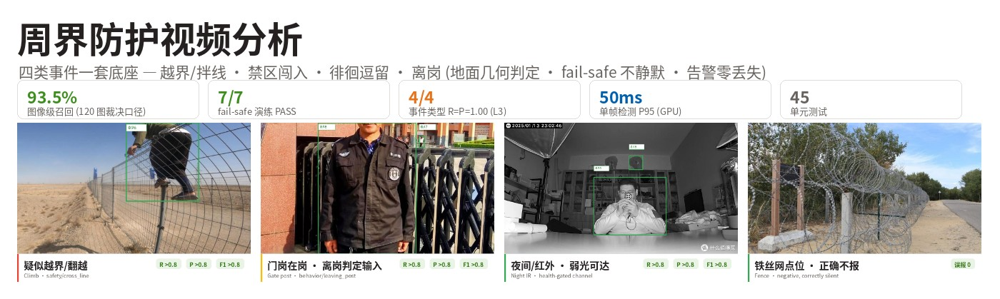
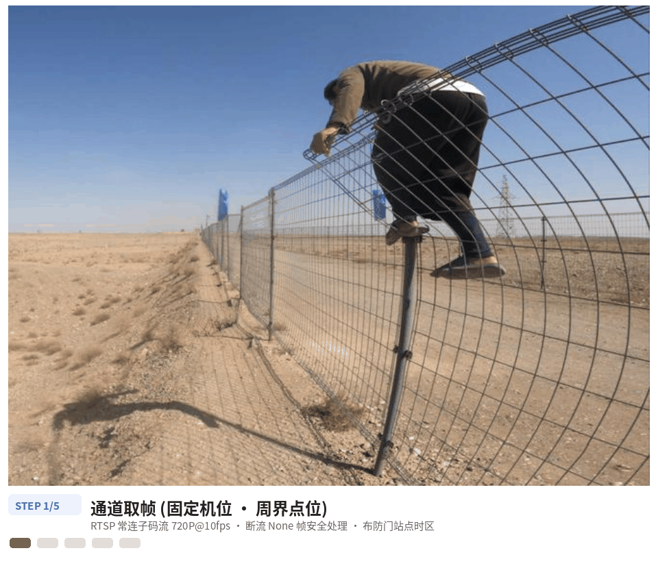
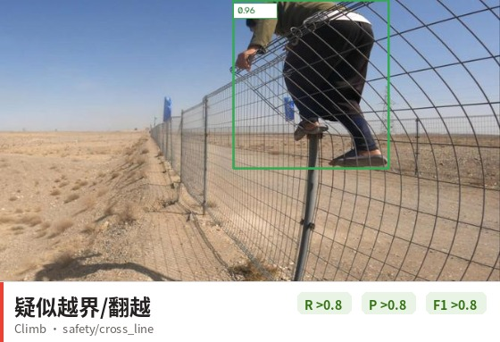
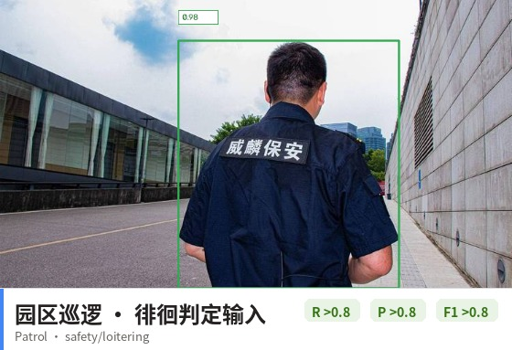
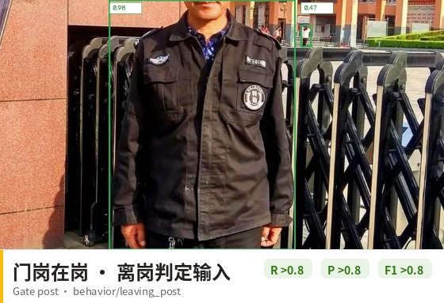
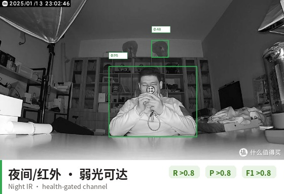
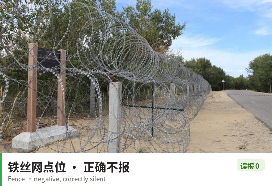
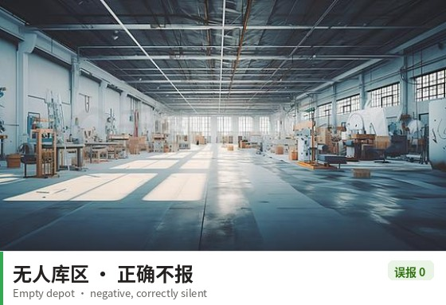
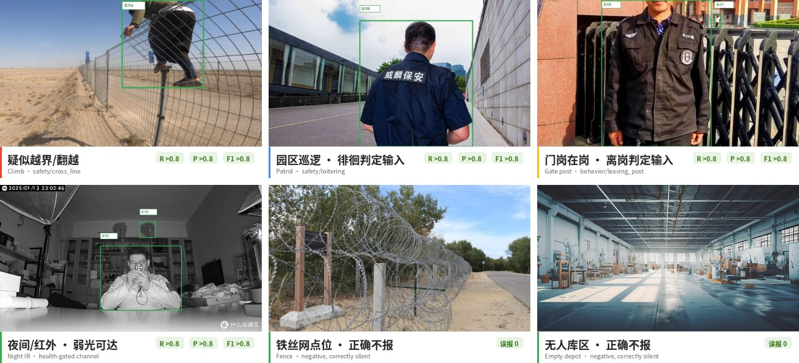
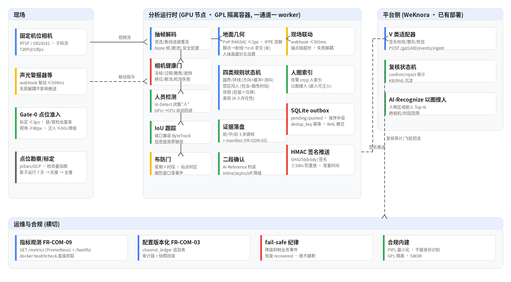

<div align="center">



**周界防护视频分析：越界/拌线 · 禁区闯入 · 徘徊逗留 · 离岗，四类事件一套底座。地面几何判定，fail-safe 不静默，告警零丢失。**


[](https://github.com/hi-agi-lab/AutoVision)
[](https://pypi.org/project/autovision-framework/)

**[English](README_en.md)** | 简体中文



*图：通道处理流程——相机异常先降级（fail-safe 不静默），人员检测走真实模型输出，判定全部在地面米制坐标系完成，告警经 HMAC 签名 outbox 推送（平台不可达零丢失）。*

</div>

---

## 1. 背景与挑战

园区/厂区/库区的固定机位周界防护是安防行业最"成熟"的场景，但把它做到
**可验收** 的企业级水平，有四项结构性难题：

| 挑战 | 常见做法的坑 |
|------|---------|
| 图像平面规则不可靠 | 直接在画面上画多边形判闯入——透视下同一个框在近处和远处代表完全不同的地面区域，误报居高不下 |
| 相机不可信无人管 | 遮挡/移位/画面冻结/散焦时检测器照跑——拿"看不见"当"没有"，漏报静默发生 |
| 告警丢失与重复 | 平台抖动时告警直接丢弃或重复轰炸；网络分区恢复后没人补投 |
| 点位差异巨大 | 夜间/红外/远景小人检出衰减；同一个算法在 A 点位 95%、B 点位 60%——没有点位准入机制就没有可承诺的指标 |

## 2. 四类事件与设计原则

| 事件 | type 标签 | 风险档 | 判定依据 |
|------|-----------|--------|---------|
| 越界/拌线 | `safety/cross_line` | risk3（高） | 脚点轨迹段与拌线的**地面**交叉 + 方向 + 缓冲走廊 + 消抖/冷却 |
| 禁区闯入 | `safety/forbidden_zone` | risk3（高） | 脚点**地面**多边形包含，进入即报/驻留报，豁免时段 |
| 徘徊逗留 | `safety/loitering` | risk2（中） | 累计驻留 × 净位移双条件，短 track 不统计 |
| 离岗 | `behavior/leaving_post` | risk2（中） | 岗位区域 K 人存在性 + 缺岗时限 + 抖动抑制 |

五条设计原则（对应设计文档 §1.3）：

1. **几何优先**——人-区域判定全部在地面米制坐标系完成：PnP 标定（含
   共面 IPPE 二义性处理）→ 脚点像素 → 射线与 z=0 平面求交 → 米制坐标。
   不做图像平面多边形。
2. **fail-safe 不静默**——遮挡/移位/冻结/散焦/过暗/断流任一健康问题 →
   通道 `system_degraded` → 抑制全部业务事件并上报 `ops/camera_health`；
   恢复产出单条 recovered。宁可漏判，绝不带病误判，绝不静默。
3. **一套底座四类复用**——检测/跟踪只算一次，四类规则状态机并行挂接
   同一份地面观测，控制 GPU 成本。
4. **误报二段确认压**——一段检出（AI-Detect 开放词汇，快）+ 二段确认
   （AI-Reference VLM，只对告警帧运行），Reference 不可用按 off 降级不阻断
   主链路。
5. **告警零丢失**——推送经本地 SQLite outbox（dedup_key 幂等），平台
   不可达时留本地补投；HMAC-SHA256 签名 + 时间窗防重放，重报全 200。

## 3. 感知与判定管线

| 环节 | 实现 | 说明 |
|------|------|------|
| 帧源 | RTSP 常连（断线退避重连）/ 视频文件 / 图片目录 | 子码流 720P@10fps 口径；None 帧（断流）安全处理不崩溃 |
| 健康门 | 六类问题逐类型记账 | 冻结/过暗/散焦(Laplacian)/遮挡(边缘密度)/移位(参考帧相关)/断流；**检测器连续异常也降级**（瞬时跳帧、持续 `detect_fail`） |
| 检测 | AI-Detect 闭集"人"（注入式后端） | GPU 加载失败自动降级 CPU；推理异常被隔离，服务不倒 |
| 跟踪 | IoU 贪心（接口兼容 ByteTrack 替换） | 低密度周界够用；密集场景见 §10 限制 |
| 布防门 | 星期 × 时段，**站点时区** | 撤防窗口零事件（连规则状态机都不推进）；跨午夜窗口归属起始日 |
| 地面几何 | `CameraGroundMapper` | PnP RANSAC + 重投影误差 ≤3px 准入 + 共面解翻转（IPPE）；人体高度按针孔模型估算（过滤动物/阴影） |
| 规则引擎 | 四类状态机并行 | 全部只消费地面观测（`GroundObs`），可纯合成数据单测 |
| 证据 | 每事件 3 关键帧（前/中/后）+ manifest | 滑动窗 + pending 补齐；对象键与 MinIO 证据桶一致 |
| 二段确认 | AI-Reference 判读（inline/async/off） | fail-operational：Reference 不可用 → `confirmed=false` 照常推送 |
| 现场联动 | webhook ≤500ms | 端点级 socket 超时；失败记账不影响推送 |
| 推送 | outbox + HMAC 签名 | 按序补投、dedup_key 幂等、时间窗 ±300s 防重放（常量时间比较） |
| 观测 | Prometheus `/metrics` + `/healthz` | docker healthcheck 直接抓取 |

## 4. 技术亮点

- **几何优先的完整工程化**——不是"标定个单应矩阵"就完事：共面点对的
  PnP 双解歧（`solvePnPGeneric` IPPE + 相机必须在地面之上）、共线点拒绝、
  重投影误差 ≤3px 的 Gate-0 准入、退化框（射线平行/背向）跳过不崩。
- **fail-safe 语义逐条可测**——降级期规则状态机冻结并清状态（不可信时段
  的半程状态不参与判定），恢复后从当前帧重新积累；每一条都有对应单测
  与 bench 演练（L2 层 7/7 PASS）。
- **检测异常隔离（实战补齐）**——共享 GPU 上一次瞬时 CUDA OOM 曾能崩掉
  整个通道进程；现在瞬时失败跳帧、连续失败 ≥30 帧（3s）通道降级并上报，
  服务进程不倒。
- **"死配置"修复的诚实记录**——`site_tz_offset_hours` 曾是声明了但从未被
  消费的配置：夜防 22:00–06:00（UTC+8 站点）实际按 UTC 判定，**整夜
  撤防、白天布防，完全反向**。现在布防与豁免窗口全部按站点墙钟解释，
  并有"北京 23:00 必须布防"的回归测试钉死。
- **断流路径自愈**——`snapshot()` 返回 None 的断流帧曾让处理循环在
  `cv2.cvtColor(None)` 上崩溃（恰是断流处理路径自身）；现在 None 帧只
  推进健康记账与门控，绝不凭空补画。
- **告警零丢失的完整链路**——SQLite outbox（WAL 模式）pending/pushed
  状态机 + 按序补投 + 平台侧 dedup_key 幂等合并；故障注入用例
  （spool_forward_zero_loss）背书。
- **合规内建**——以图搜人只匹配外观特征不输出身份（PIPL 最小化）；
  离岗仅统计存在性不采生物特征；GPL-3.0 底座进程/容器隔离，平台只经
  适配器传 JSON 与对象键。

## 5. 效果图

以下标注均为真实管道输出（AI-Detect 检出框与置信度取自检出缓存
`images/detections.json`，与评测 bench 同模型同阈值，未经手工修改）。

四类事件域的真实检出（每张含检出框、置信度与事件级 SLO 徽标）：

| 越界/翻越 | 巡逻/徘徊域 | 门岗/离岗域 |
|:---:|:---:|:---:|
|  |  |  |
| **夜间/红外** | | |
|  | | |

负例正确不报（系统的另一半能力）：

| 铁丝网点位 | 无人库区 |
|:---:|:---:|
|  |  |

总览：



## 6. 端到端流程示例

以一次夜间翻越为例（时间为示意，判定与路由为真实逻辑）：

| 时刻 | 环节 | 说明 |
|------|------|------|
| 23:41:02 | 布防检查 | 布防窗口 22:00–06:00（站点时区 UTC+8）内，判定开启 |
| 23:41:05 | 检出 | 人员检出 0.87，IoU 跟踪获得稳定 track |
| 23:41:06 | 地面换算 | 脚点射线求交 → 地面 (3.2, 2.8)m，投影高度 1.6m（>0.5m 尺寸门槛） |
| 23:41:07 | 拌线判定 | 轨迹段与拌线地面交叉、方向 a→b 相符、越线后连续 2 帧在新侧（消抖通过） |
| 23:41:07.1 | 证据落盘 | 前/中/后 3 关键帧 + manifest 写入证据 spool |
| 23:41:07.2 | 二段确认 | AI-Reference 判读"画面中是否存在真实人体" → 确认（inline 预算 1.2s 内） |
| 23:41:07.3 | risk3 告警 | `safety/cross_line` 线索入 outbox → HMAC 签名推送平台 201 |
| 23:41:07.4 | 现场联动 | webhook 触发声光警报（≤500ms，失败不影响已推送告警） |
| 23:41~次日 | 冷却期 | 同目标同线 60s 内不重复告警 |
| 案后 | 以图搜人 | 目标人框已在告警时入 AI-Recognize 索引 → 跨相机/时段回溯 |

同夜相机被喷漆遮挡：3 帧内边缘密度塌陷 → `occlusion` → 通道降级，
`ops/camera_health` 上报，**业务事件零产出**——画面不可信时宁可漏判，
绝不静默。

## 7. 关键指标

基准口径：**336 张真实图片、两轮独立百度图片抓取（216 + 120，内容哈希
去重），弱标注（查询意图即标注）+ 人工裁决双口径**，检测模型与评测
bench 完全一致。详见 [评测报告](../../work_dirs/perimeter_bench_v2_fixed/report.md)。

| 层 | 口径 | 结果 |
|------|------|------|
| L1 感知 | v2 120 图 · 人工裁决口径 | **召回 93.5% @ FPPI ≤0.036**（保守口径：存疑误检计入负例；严格裁决口径为 0），GPU 单帧 P95 50ms |
| L1 感知 | v1 216 图 · 人工裁决口径 | 召回 91.9% @ FPPI 0.07（两轮独立抓取结论一致） |
| L1 感知 | 弱标注原始口径 | v2: 63.1% @ FPPI 0.25——失真主因是标注噪声（商品图无人/"空"图有人），逐图审计见裁决文件 |
| L2 管线 | 健康门/布防门注入演练 | **7/7 PASS**（冻结/断流/遮挡/散焦/过暗/恢复/布防门），降级期业务事件为 0 |
| L3 规则 | 四类事件脚本轨迹 ×5 重复 | **R=P=1.00**（对照 §5.1 目标 R≥0.85~0.98 / P≥0.80~0.98 全过） |
| 工程 | 单元测试 | 45 项，无 GPU 环境全量运行 |

> **诚实口径**：L1 为网络图片弱标注 + 人工裁决，是感知健壮性参考，
> **不替代 §8.2 现场验收集**（每点位 ≥2000 帧标注 + 摆拍正例 ≥300 次 +
> 负例录像 7 天×4 路，尚未建设）；L3 为脚本化轨迹在真实几何链路上的
> 事件演练，验证规则/状态机/几何/门控正确性。残余漏检集中在夜间/红外
> 远景与非常规构图两类——由 Gate-0 点位准入（夜帧基准/视场 ≥80px）
> 管住，不靠调阈值硬凑，不进告警通道。

## 8. 快速开始

```bash
# 单元测试 (无需模型/GPU)
python -m pytest perimeter_guard/tests -q

# 图片集三层评测 (L1 感知 / L2 管线 fail-safe / L3 规则事件级)
# --person-model 即 AI-Detect 权重 (模型目录: wedetect_hf_models/wedetect-tiny);
# --device 缺省自动选卡 (传 cpu 可强制 CPU; 不要传 auto)
python -m perimeter_guard.bench \
    --images data/perimeter_eval_v2/images \
    --manifest data/perimeter_eval_v2/manifest.jsonl \
    --person-model wedetect_hf_models/wedetect-tiny \
    --out-dir work_dirs/perimeter_bench
```

```python
from perimeter_guard.config import load_channel_config
from perimeter_guard.runner import ChannelRunner
from perimeter_guard.service import (build_person_detector, build_confirm,
                                     build_linkage, build_person_index)
from perimeter_guard.store import PerimeterStore

cfg = load_channel_config("perimeter_guard/deploy/config.example.json")
store = PerimeterStore(cfg.store_path)
runner = ChannelRunner(
    cfg,
    person_detector=build_person_detector(cfg),   # GPU 失败自动降级 CPU
    confirm=build_confirm(cfg),                   # AI-Reference 二段确认
    linkage=build_linkage(cfg),                   # 声光警报 webhook
    person_index=build_person_index(cfg),         # 以图搜人索引
    store=store)                                  # 告警零丢失 outbox
```

```bash
# 通道服务 (真实模型, RTSP 常连; /metrics + /healthz 端口可配)
python -m perimeter_guard.service --config perimeter_guard/deploy/config.example.json

# GPL 隔离容器部署 (模型/证据卷挂载)
cd perimeter_guard/deploy && docker compose up -d
```

## 9. 系统架构



## 10. 范围与限制

- **现场验收集未建设**：当前指标来自网络图片集（弱标注 + 人工裁决）与
  脚本化轨迹演练；§8.2 规定的点位验收集（≥2000 帧标注）、摆拍正例
  （≥300 次）、负例录像（7 天×4 路）尚未建设——正式验收依赖现场数据。
- **夜间/红外远景与非常规构图**：两轮评测残余漏检一致集中在夜帧远小
  目标与个别非常规构图样张（§7）；上线路径是 Gate-0 点位夜帧准入 +
  补光/改机位，而不是调阈值硬凑。
- **跟踪器**：IoU 贪心在密集交叉场景会换 ID（低密度周界可接受），
  高密度点位需替换 ByteTrack（接口兼容）。
- **拌线只支持单直线段**：折线需拆成多条 line 配置，拐角处一次穿越
  会按两条线各报一次（配置语义已文档化）。
- **以图搜人嵌入**：缺省缩略图嵌入仅供联调，生产替换 AI-Recognize
  人框嵌入（接口不变）。
- **凭证加密**：平台 secret 目前明文存放于配置文件，等保三级要求的
  AES-256-GCM 落盘加密在路线图上。

## 11. License 与数据声明

代码为商业软件（Commercial Software），未经授权不得复制、修改、分发或
商用。评测图片来自百度图片搜索，**不随仓库分发**（`fetch_images_v2.py`
提供可复现抓取，标注仅供研究）；`detections.json` 检出缓存与评测报告
随仓库提供。系统上线前每点位必须通过 Gate-0 准入（标定 ≤3px、昼/夜
检出基准、视场 ≥80px、健康注入 ≤60s 降级）；员工离岗监控需甲方提供
制度依据并事先告知（PIPL）。

---

本方案的检测底座、流式推理运行时与导出链路由开源框架 [AutoVision](https://github.com/hi-agi-lab/AutoVision) 提供（`pip install autovision-framework`）；接入设计见[《行业方案接入》](https://hi-agi-lab.github.io/AutoVision/ecosystem/)。
