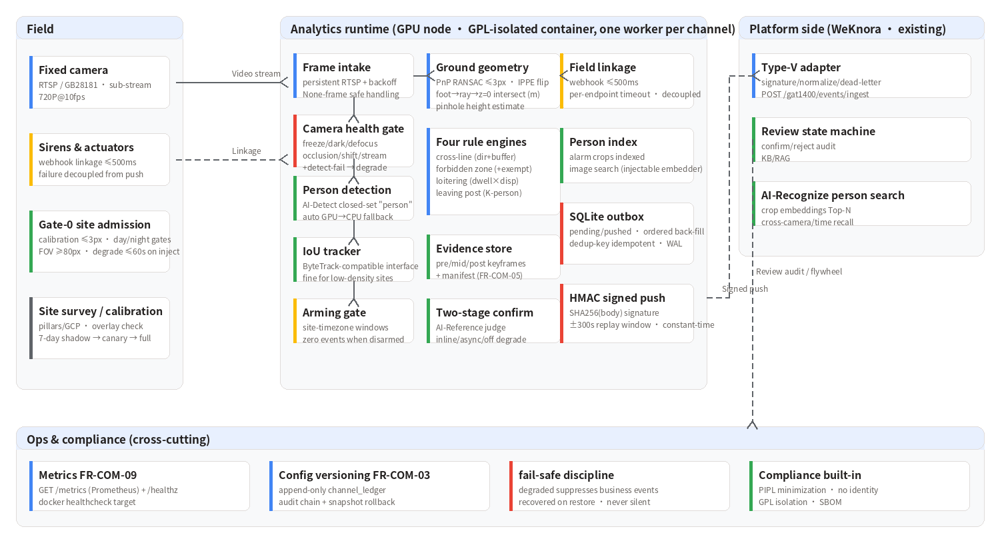

<div align="center">


**Enterprise perimeter defense video analytics: cross-line, forbidden-zone intrusion, loitering and leaving-post — four event types on one perception stack. Ground-plane geometry, fail-safe degradation, zero alert loss.**


English | **[简体中文](README.md)**


*Figure: channel processing — unhealthy cameras degrade first (fail-safe, never silent), person detection runs a real open-vocabulary model, all rule decisions happen in metric ground coordinates, alerts leave through an HMAC-signed outbox (zero loss when the platform is down).*

</div>

---

## 1. Why this is hard

Fixed-camera perimeter defense looks like a solved problem — until you have
to pass acceptance:

| Challenge | What usually goes wrong |
|------|---------|
| Image-plane rules are unreliable | Drawing polygons on the image ignores perspective: the same pixels mean completely different ground areas near vs. far, so false positives never stop |
| Untrustworthy cameras go unnoticed | Occluded / shifted / frozen / defocused cameras keep "detecting" — blindness silently becomes missed alarms |
| Alerts get lost or duplicated | Platform hiccups drop or double-fire alerts; nobody back-fills after a network partition |
| Site variance is huge | Night/IR and tiny far targets degrade detection; the same algorithm hits 95% at site A and 60% at site B — without per-site admission there is no promise to make |

## 2. Four event types, five design principles

| Event | type tag | Risk | Decision basis |
|------|-----------|--------|---------|
| Cross-line | `safety/cross_line` | 3 (high) | Foot-point trajectory vs. line intersection **on the ground** + direction + buffer corridor + debounce/cooldown |
| Forbidden zone | `safety/forbidden_zone` | 3 (high) | Ground-polygon containment, enter/dwell modes, exempt windows |
| Loitering | `safety/loitering` | 2 (mid) | Accumulated dwell × net displacement; short tracks excluded |
| Leaving post | `behavior/leaving_post` | 2 (mid) | K-person presence + absence timeout + jitter suppression |

1. **Geometry first** — person-zone decisions happen in metric ground
   coordinates: PnP calibration (incl. planar IPPE ambiguity handling) →
   foot point → ray–plane intersection. No image-plane polygons.
2. **Fail-safe, never silent** — any camera health issue (occlusion /
   shift / freeze / defocus / darkness / stream loss) degrades the channel,
   suppresses business events and raises `ops/camera_health`. Degraded rule
   state is frozen and cleared; recovery restarts from the current frame.
3. **One stack, four rules** — detection and tracking run once; four rule
   state machines consume the same ground observations.
4. **Two-stage false-alarm suppression** — fast open-vocabulary detection,
   then a VLM second look (AI-Reference) on alarm frames only; Reference
   unavailability degrades to off without blocking the alert path.
5. **Zero alert loss** — local SQLite outbox with idempotent dedup keys,
   ordered back-fill, HMAC-SHA256 signatures and a ±300 s replay window.

## 3. Key results

Benchmark: **336 real images from two independent Baidu crawls (216 + 120,
content-hash deduped), weak labels (query intent) + manual adjudication**;
same model and threshold as the evaluation bench. Full report:
[work_dirs/perimeter_bench_v2_fixed/report.md](../../work_dirs/perimeter_bench_v2_fixed/report.md).

| Layer | Protocol | Result |
|------|------|------|
| L1 perception | v2 120 images, adjudicated | **Recall 93.5% @ FPPI ≤0.036** (conservative: the one disputed FP counted as negative; strict adjudication = 0), GPU P95 50 ms/frame |
| L1 perception | v1 216 images, adjudicated | Recall 91.9% @ FPPI 0.07 (consistent across crawls) |
| L2 pipeline | health/arming fault drills | **7/7 PASS**, zero business events while degraded |
| L3 rules | scripted trajectories ×4 event types | **R = P = 1.00** vs. SLO R≥0.85–0.98 |
| Engineering | unit tests | 45, fully CPU-runnable |

> **Honest protocol**: L1 numbers are perception robustness on web images,
> **not** a substitute for the on-site acceptance sets of the design doc
> (≥2000 labeled frames per site, ≥300 staged intrusions, 7-day×4-camera
> negative footage — not built yet). Residual misses are dominated by tiny
> night/IR targets plus a few unusual compositions — handled by per-site
> Gate-0 admission (night gates / target height ≥80 px), not by tuning.

## 4. Quick start

```bash
# Unit tests (no GPU, no model weights required)
python -m pytest perimeter_guard/tests -q

# Three-layer image benchmark (L1 perception / L2 fail-safe / L3 rule events)
# --person-model is the AI-Detect weights (model dir: wedetect_hf_models/wedetect-tiny);
# omit --device for auto selection (pass cpu to force CPU; never pass auto)
python -m perimeter_guard.bench \
    --images data/perimeter_eval_v2/images \
    --manifest data/perimeter_eval_v2/manifest.jsonl \
    --person-model wedetect_hf_models/wedetect-tiny \
    --out-dir work_dirs/perimeter_bench

# Channel service (real model, persistent RTSP; /metrics + /healthz)
python -m perimeter_guard.service --config perimeter_guard/deploy/config.example.json

# GPL-isolated container deployment
cd perimeter_guard/deploy && docker compose up -d
```

## 5. System architecture



## 6. Scope and limitations

- **On-site acceptance sets not built yet** (see honest protocol above).
- **Night/IR tiny targets**: residual misses; path forward is Gate-0 night
  admission + better lighting/positioning, not threshold hacks.
- **Tracker**: greedy IoU switches IDs in dense crowds — swap in ByteTrack
  (drop-in interface) for high-density sites.
- **Cross-line supports straight segments only**: polylines must be
  configured as multiple lines; a corner crossing alerts once per segment.
- **Person-search embeddings**: default thumbnail embedder is for
  integration testing; production injects AI-Recognize embeddings.
- **Credential encryption**: platform secret is stored in plain text;
  AES-256-GCM at rest is on the roadmap.

## 7. License and data

Commercial software; no copying, modification, distribution or commercial
use without authorization. Benchmark images come from Baidu image search
and are **not distributed with the repository** (`fetch_images_v2.py`
reproduces the crawl; labels are for research only); the detection cache
and evaluation reports ship with the repo. Every site must pass Gate-0
admission (calibration ≤3 px, day/night recall gates, target height
≥80 px, health drills ≤60 s) before going live; employee leaving-post
monitoring requires the site owner's policy basis and prior notice (PIPL).
